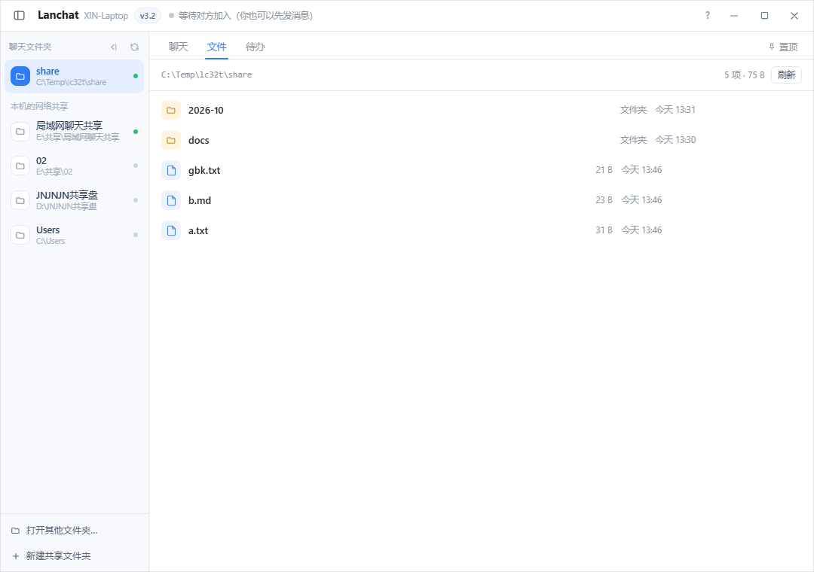
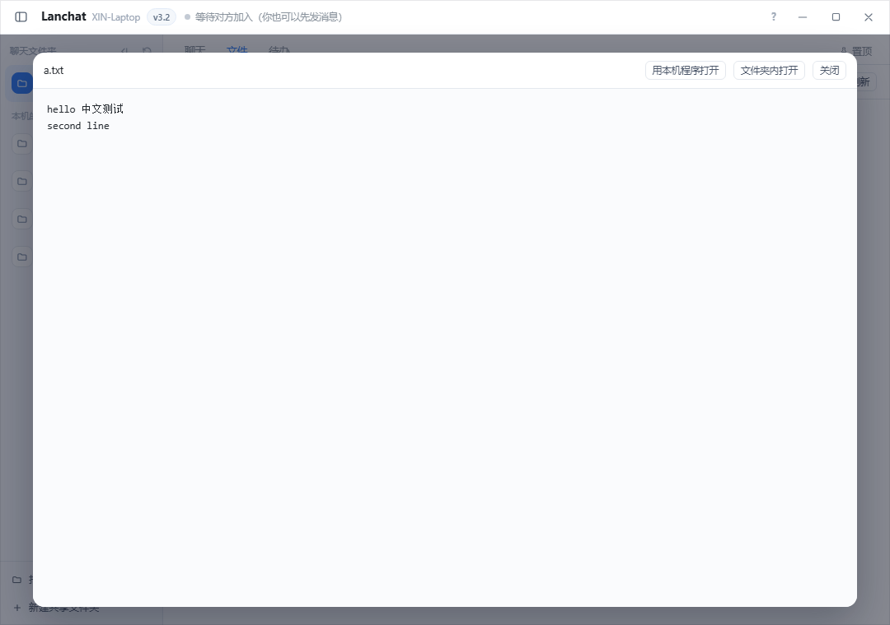

# Lanchat

局域网里两台电脑之间**聊天 + 传文件**的工具。不经过服务器、不需要账号、不需要互联网。

一个 6.8 MB 的单文件 exe，双击就是一个独立窗口。消息、图片、文件全都直接写进一个共享文件夹——那个文件夹你随时可以用资源管理器打开，也可以用别的电脑访问。



## 为什么不用微信/QQ 传

在同一间办公室或同一个家里的两台电脑之间搬文件，最常见的做法是登录 IM、把文件发给自己、另一台再下载。这套流程有几个不太舒服的地方：

- 要登录，要联网，断网就没法用
- 文件先被上传到别人的服务器上再拉回来，大文件慢，而且多一份副本在云上
- 传完的文件散落在下载目录里，改名、挪位置、再传一次都得手动来

Lanchat 换了个思路：**两台电脑共享同一个文件夹，聊天只是这个文件夹的一个视图**。发出的文件和文件夹用原来的名字直接落在共享目录里，两台电脑的资源管理器里都能看见、能改、能继续编辑。聊天记录本身也是文件，就在同一个目录下。

## 功能

### 聊天

- 文本、图片（可粘贴）、任意文件和文件夹
- 每个气泡悬停有 **复制 / 文件夹内打开 / 另存为**，自己发的和对方发的都一样
- 「文件夹内打开」在对方电脑上时也能正确弹出——即使共享目录在本机只是一个映射盘符
- 在线状态、昵称、输入中提示
- 输入框里打 `@` 弹出在线设备候选，消息右键可直接「＠ 提到 XXX」
- 支持 AI 机器人：配套的 Lanbot 按同一份文件协议另写了一个实现，机器人消息有紫色头像和 `AI` 标签，回复逐字冒出

### 文件（v3.2）

共享文件夹不再只是聊天的附件落脚点，可以直接当盘用：

- **文件视图**：文件夹在前、按修改时间倒序，显示真实路径和总大小，可进子目录
- **在线预览**：文本 / 代码 / CSV / JSON / PDF / 图片 / 音视频，不用先「另存为」
- **变动通知**：别人从资源管理器放进来的文件，聊天里会提示一句
- **归档建议**：根目录散文件按月份归到 `2026-10\` 这样的子目录，先给建议再动手

### 传输

- **断点续传**：传一半断了，下次只补剩下的部分（靠残留的 `.part` 文件判断进度）
- **并发复制**：文件夹 4 路并发，不是一个个排队
- **打包发送**：30 个以上文件时先问一句「打包成一个 zip 还是原样铺开复制」
- 全程有进度和速度显示，可以中断

### 协作（v3.2）

- **待办清单**：多人共享一份，勾掉时记下是谁、什么时候完成的
- **置顶公告**：一条贴在聊天区顶部的说明，点 × 只在本机收起

### 其他

- 无边框窗口、圆角、托盘、开机自启（可选）
- 剪贴板粘贴图片直接发
- 窗口尺寸、侧边栏收起状态、昵称都记在配置文件里，重启不丢

## 快速开始

### 直接运行

1. 把 `Lanchat.exe` 拷到两台电脑上（免安装，放哪都行）
2. 在**其中一台**（当作「房主」）双击，点左下角「＋ 新建共享文件夹」
3. 填好位置、文件夹名，保持「同时开启 Windows 网络共享」勾选，点「创建」——程序会建目录、开 SMB 共享、配好权限，一次做完
4. 另一台电脑打开 Lanchat，在「打开其他文件夹」里填入房主给出的共享地址（`\\主机名\共享名`，或者直接点侧边栏里自动出现的条目）

之后两台电脑各自打开自己的 Lanchat，看到的就是同一个共享文件夹。

### 系统要求

- Windows 10 / 11（64 位）
- WebView2 Runtime —— Win11 自带，Win10 一般随 Edge 一起装了。没装的话从微软官网装一个
- 两台电脑在同一局域网，且能互相访问 SMB（防火墙允许「文件和打印机共享」）

首次运行会被 SmartScreen 拦一下（未签名程序的正常提示），点「更多信息 → 仍要运行」。

## 它是怎么工作的

没有自定义网络协议，只有一个约定好的目录结构。所有数据都是普通文件，出问题时用记事本就能查。

```
共享文件夹/
├── 你发过去的报告.docx          ← 文件消息直接落在这里，用原来的名字
├── 某个项目文件夹/              ← 文件夹消息同理，整个目录搬过来
└── _lanchat/                    ← 程序自己的元数据，可以当它不存在
    ├── msgs/                    ← 一条消息一个 json 文件
    ├── blobs/                   ← 图片（粘贴来的图片没有文件名，所以单独存）
    ├── peers/                   ← 每台在线设备一个 json，心跳
    ├── todo.json                ← 待办清单
    └── pin.md                   ← 置顶公告
```

几个值得一提的设计取舍：

**消息文件名本身就是索引。** 文件名是 `13位时间戳-6位随机.json`，字典序天然等于时间序。所以「取最近 300 条」「取比某条更早的 200 条」完全在文件名上算，不用打开文件、不用 `stat`。几千条记录时启动加载从几十秒降到 1 秒内。

**变动通知不用 `ReadDirectoryChangesW`。** 那套 API 在本地磁盘可靠，但在 SMB 共享上经常静默失效，而且代码量要大十倍。这里用的是每 2.5 秒拍一次目录快照、比对差异——慢一点，但在网络盘上一样能用。程序自己写文件时会留个记号，避免把自己的操作也报成「别人放进来的」。

**打包发送的 zip 是在页面里手写的。** 从资源管理器拖进来的文件夹，浏览器只给 `File` 对象，拿不到绝对路径，Go 那边读不到磁盘上的原始位置。所以 zip 头（本地文件头 30 字节 + 中央目录 46 字节 + EOCD 22 字节）、CRC32 查表、`CompressionStream('deflate-raw')` 全部在页面里实现，不引第三方库。

**身份存在后端，不在浏览器里。** exe 每次启动监听的端口是随机的，页面 origin 每次都变，`localStorage` 相当于换了个空抽屉。昵称和 `peerId` 因此存在 `%APPDATA%\LanChat\config.json` 里——这也是 v3.1 修掉「重启后自己的消息跑到左边」的原因。

**中文文本预览只校验前 4KB。** 判断文件是不是 UTF-8 时不能对整个文件做 `utf8.Valid`：文件被截断在 2MB 处，截断点可能正好切在一个汉字中间，会误判成 GBK。所以只看开头 4KB，后面按需砍掉末尾最多 3 个不完整字节；确实不是 UTF-8 就走 `MultiByteToWideChar(CP_ACP)` 转一遍。

## 编译

需要 Go 1.23+，Windows 上编译（用到了 `netapi32` 和 WebView2，非 Windows 平台编不过）：

```bat
go build -trimpath -ldflags "-H windowsgui -s -w" -o Lanchat.exe .
```

或者直接双击 `重新编译.bat`。产物是单文件，运行时不依赖同目录的其他东西。

图标来自 `build\icon.ico`，通过 `rsrc_windows_amd64.syso` 编进 exe 资源。这个 `.syso` 必须留在目录里，删掉也能编，只是图标会退回代码绘制的近似版。

## 测试

```bash
bash tests/run_self.sh    # 页面内置自检：30 项布尔断言 + 12 项计数
bash tests/run_v32.sh     # 真后端 + 无头 Chrome 的完整验收
```

第二个脚本覆盖文件视图、预览、待办增删勾、置顶、变动通知、断点续传（5 MB 文件带 2 MB 残留 `.part`，最终必须正好 5242880 字节）、打包发送、归档，最后用 Python 的 `zipfile.testzip()` 独立校验生成出来的 zip。

两个脚本都会在 `C:\Temp` 下建独立的配置目录（通过 `APPDATA` 环境变量隔离），不会动到你正在用的设置。

## 已知限制

- **只在 Windows 上跑**。SMB 共享、`netapi32`、DPAPI、WebView2 都是 Windows 专有的
- **没有加密**。共享文件夹在同一局域网里是可见的，别再往外开端口或者映射到公网
- 删除一条文件消息只删聊天记录，共享目录里的真身不动——这是刻意的，防止手滑删掉别人的文件
- 变动通知只盯根目录一层，子目录里的变化不提示
- 运行过归档之后，老消息气泡上的「文件夹内打开」会失效（文件已经挪到月份子目录里了）
- 断点续传的前提是 `.part` 文件还在，重启电脑或换目录都会从头发

## 版本

当前 **v3.2**（2026-10-26）。完整的历史变更见 [更新日志.txt](更新日志.txt)，逐条功能说明见 [使用说明.txt](使用说明.txt)。

## 截图

| 文件视图 | 在线预览 |
|---|---|
|  |  |

| 待办清单 | 置顶公告 |
|---|---|
|  |  |

## 许可

暂未指定许可证。如果你要拿它做点什么，先开个 issue 说一声。
